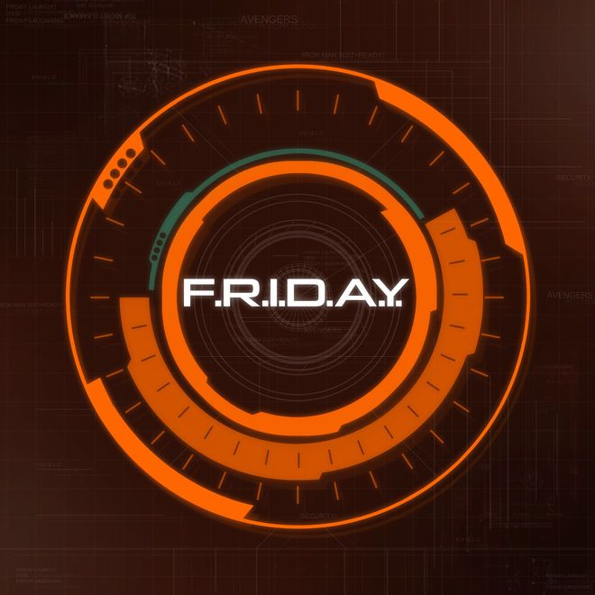

# F.R.I.D.A.Y.

Personal AI Assistant — desktop app with a FastAPI backend, Electron shell, and Next.js frontend.

## Screenshots

### App icon


### Background texture


## Features

- FastAPI backend with HTTP + WebSocket endpoints
- Event-driven voice loop and command processing
- Background runtime services (startup/shutdown, service toggles)
- Next.js web frontend
- Electron desktop shell (`FRIDAY.app`, `FRIDAY.command`)

## Tech Stack

| Layer | Technology |
|-------|------------|
| Desktop shell | Electron |
| Backend | FastAPI (Python) |
| Frontend | Next.js |
| Styling | Tailwind CSS |

## Project Structure

```
Friday/
├── FRIDAY.app               # Built macOS desktop app
├── FRIDAY.command           # Launcher script
├── FRIDAY.jpg               # App icon
├── backend/                 # FastAPI backend (services, API routes)
├── frontend/                # Next.js frontend
├── browser-agent/           # Browser automation agent
├── browser-automation/      # Browser control scripts
├── scripts/                 # Helper / launcher scripts
└── docs/                    # Design notes
```

## Getting Started

```bash
# Install frontend dependencies
cd frontend && npm install && cd ..

# Start the desktop app
bash scripts/friday-launcher.sh
```

## License

MIT
